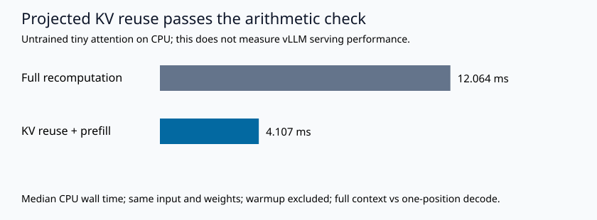

# Inference Systems Lab

**A serving benchmark is useful only after its measurement contract survives failure.**

I built this independent lab to connect three questions that are often measured separately: did the streamed request finish, was the answer acceptable, and could the deployment deliver it within a declared latency and cost limit?

The narrower engineering problem is easy to miss. A streaming event can contain several tokens. A fast malformed answer can pass a latency chart. A fallback can improve quality while quietly doubling attempts. I wanted a runnable way to expose each of those cases before recommending a GPU or serving provider.

## What the code does

- Implements an OpenAI-compatible SSE client for configured vLLM and Nebius Token Factory endpoints, with UTF-8/event boundaries, HTTP failures, connected-socket deadline enforcement and bounded response size. Connection-setup limits are explicit in the measurement contract.
- Executes a bounded, closed-loop finite batch with separate transport, exact JSON/label, SLO and release gates. Rejected primary answers retain their latency and usage when a fallback runs.
- Preserves missing usage as unknown. Manual input/output rates support per-attempt cost and an economic-only requests/second crossing with dedicated hourly cost.
- Implements a small causal-attention layer in PyTorch and compares full-context recomputation with projected KV reuse. The CPU path uses wall time; the conditional CUDA path uses synchronized events and NVTX ranges.
- Generates a numerical artifact, raw traces, a chart and a case study from the same measurements.
- Includes five fictional contract-extraction examples and a strict source-span/field gate for document-evaluation demonstrations.

## Evidence available now

| Component | Status and scope |
| --- | --- |
| Original Python implementation and tests | Executed locally; see the commands below |
| Streaming HTTP integration | Executed against a known-answer loopback fixture; not a provider benchmark |
| Tiny attention equivalence/timing | Executed with Torch 2.9.1+cpu, float32, one CPU thread |
| NVIDIA CUDA attention | Executed separately on a free Colab Tesla T4; see [hardware evidence](results/colab-t4/) |
| vLLM GPU serving and prefix-cache comparison | Not run; deployment and collection scripts provided |
| Nebius managed inference | Not run; no provider requests or credits consumed |
| NVIDIA Nsight Systems | Not run; profiling commands provided |

Read the [generated case study](results/case-study.md), [metrics](results/metrics.json), [raw traces](results/traces.jsonl), and [data card](data/DATA_CARD.md). The chart is a toy attention experiment, not evidence of vLLM/GPU speed or production savings.

The separate [Tesla T4 CUDA check](results/colab-t4/) passed the declared float16 correctness tolerance. Seven-trial medians were 25.626 ms for full recomputation and 20.790 ms for KV reuse. Its configuration, raw repetitions and source revision are retained independently of the original CPU/loopback artifacts. These tiny attention measurements do not establish serving performance or a CPU/GPU comparison.



## Run locally, without provider spend

Python 3.11.9 is the tested interpreter. Other versions need a compatible PyTorch build. The transport and contract gate use the standard library. Install a CPU build of PyTorch in an isolated environment if it is not already available:

```powershell
python -m venv .venv
.venv\Scripts\Activate.ps1
python -m pip install torch==2.9.1 --index-url https://download.pytorch.org/whl/cpu
python -m unittest discover -s tests -v
python -m inference_lab demo
python -m inference_lab doctor --out results/doctor.json
```

The demo sends 12 requests to an ephemeral loopback lookup server and executes the actual tiny attention arithmetic. No model download, provider call, paid service or cloud allocation occurs. Process-local thread limits are set before numerical imports. Results vary with background load; source tensors and model weights are reproducible from seed 42.

```powershell
python -m inference_lab demo --out runs/my-local-check
python -m inference_lab report --out runs/my-local-check
python -m inference_lab kv --device cuda --dtype float16 --out runs/cuda-attention.json
python -m inference_lab compare results/metrics.json results/metrics.json
```

The CUDA command records `not_run_cuda_unavailable` if CUDA is missing. A same-file release comparison only demonstrates the gate; it does not establish a model improvement. Reports generated outside the repository still link back to the actual source documentation.

## Run on a free GPU when one is available

Open [the interactive Colab notebook](https://colab.research.google.com/github/VEDANT1602/DataScienceProject/blob/master/projects/inference-systems-lab/notebooks/free_gpu_lab.ipynb). It sparse-checks out only this lab, records the resolved repository commit, and starts with a CUDA capability check. The tiny CUDA experiment uses the notebook's available Torch runtime. An optional, separately enabled in-process vLLM cell uses a small public model and records its exact revision.

Colab GPU access is free but not guaranteed or unlimited. The notebook uses interactive cells without SSH, tunnels or an external web interface. Leave the optional vLLM install disabled if compatibility checks fail or no GPU is assigned. [Colab FAQ](https://research.google.com/colaboratory/faq.html)

## Move to a configured endpoint

Start with the [GPU runbook](docs/gpu-runbook.md), [vLLM migration guide](docs/migrate-to-vllm.md), or [Nebius migration guide](docs/migrate-to-nebius.md). Endpoint URLs and model identifiers are configuration, never values read from workload data. API keys are read from environment variables and excluded from traces and error messages. Remote requests require `--execute-remote`; local vLLM uses loopback by default.

The user requested zero extra spend. The committed path therefore uses local CPU and a conditional free Colab notebook. Nebius promotional credits are eligibility- and expiry-dependent; the adapter does not assume free usage and has not been executed.

## Read the implementation

| Need to inspect | File |
| --- | --- |
| Incremental streaming and endpoint guards | [protocol.py](inference_lab/protocol.py) |
| Queue, quality, fallback, cost and release math | [benchmark.py](inference_lab/benchmark.py) |
| Actual causal-attention and KV arithmetic | [kv.py](inference_lab/kv.py) |
| Fictional contract extraction gate | [contract_gate.py](inference_lab/contract_gate.py) |
| Socket-level fixture and failure modes | [fixture.py](inference_lab/fixture.py) |
| Narrative and chart generation | [report.py](inference_lab/report.py) |
| Twenty-minute teaching artifact | [workshop](docs/workshop-20-minutes.md) |

## What I would decide next

The local result supports the correctness of the checked transport, accounting and tensor paths. It does not select a GPU or provider. Next I would run the same pinned workload on a known NVIDIA GPU, verify cache reset/hit evidence, repeat cold/warm trials, and retain quality and failure denominators while varying concurrency. Only then would I use sustainable SLO goodput alongside prices to make a capacity decision.

This is new portfolio work by **Vedant Thaker**. It demonstrates current implementation and technical communication. It is not private employer/client code and does not validate earlier business metrics, adoption counts, audience reach or upstream contribution status. vLLM, NVIDIA and Nebius references describe integration targets and tools, not affiliations or endorsements.

Conceptual inspiration: [Build Your Own X](https://github.com/codecrafters-io/build-your-own-x). This implementation, workload, experiments and narrative are original; no tutorial repository was copied. See [primary sources and version notes](docs/sources.md).
